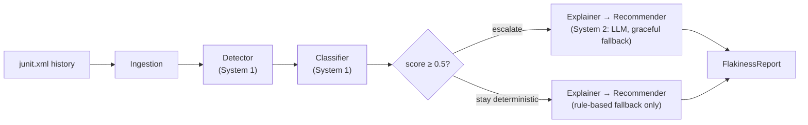

# FlakySense

**Flaky test intelligence agent — detects, classifies, and explains flaky tests from CI run history using log analysis, temporal correlation, and multi-step AI agent orchestration.**

[](https://github.com/BazanJeremy/flakysense/actions/workflows/ci.yml)
[](tests/)
[](pyproject.toml)
[](LICENSE)

> 🇫🇷 [Version française](README.md)

**Status:** ✅ v1 complete — detection pipeline, CLI, and Docker packaging
delivered. Part of a series of AI-augmented QA tools — see also
[anomaly-sentinel](https://github.com/BazanJeremy/anomaly-sentinel).

## Why

Flaky tests erode trust in CI signals and waste engineering time. FlakySense
turns raw JUnit run history into an actionable diagnosis: a flakiness score,
a probable root cause, an evidence-grounded explanation, and a concrete
corrective action — with a fully deterministic fallback at every stage, so
the entire pipeline runs in CI with **zero API keys**.

## What it does

```
$ flakysense data/samples/ci_runs
FlakySense - analyzed 5 tests across 10 runs: 3 flaky

tests/test_users.py::test_user_profile_cache
  flakiness 0.70 | cause: ordering (confidence 0.80) | path: system1_fallback
  explanation:    Test 'tests/test_users.py::test_user_profile_cache' failed 4 of 10
                  recorded runs (flakiness score 0.70). Probable cause: ordering
                  (confidence 0.80). Evidence: failures only at suite position(s) [3],
                  passes only at [2].
  recommendation: Isolate shared state between tests; rerun the test alone and under
                  randomized ordering to confirm the dependency, then remove it.
  ...
```

Exit codes follow the grep convention
([ADR-006](docs/adr/ADR-006-cli-contract.md)): `0` = no flaky test,
`1` = flaky tests found — so a pipeline can gate on flakiness directly —
`2` = analysis error. `--json` emits the same reports serialized straight
from the Pydantic models, full run evidence included.

## Architecture

A four-stage agent pipeline following the System 1 / System 2 dual-process
pattern ([ADR-001](docs/adr/ADR-001-orchestration-pattern.md)): deterministic
statistics where the volume is, LLM reasoning where the value is.



| Stage | Agent | System | Role |
|---|---|---|---|
| 1 | `DetectorAgent` | System 1 — deterministic, always runs | Scores flakiness: intermittency + flip rate + duration instability ([ADR-002](docs/adr/ADR-002-flakiness-scoring-heuristic.md)) |
| 2 | `ClassifierAgent` | System 1 — deterministic, always runs | Names the probable cause: duration outliers, order splits, environment diffs ([ADR-003](docs/adr/ADR-003-cause-classification-heuristics.md)) |
| 3 | `ExplainerAgent` | System 2 — LLM with deterministic fallback | Root-cause narrative grounded in System 1 evidence ([ADR-004](docs/adr/ADR-004-system2-llm-integration.md)) |
| 4 | `RecommenderAgent` | System 2 — LLM with deterministic fallback | Corrective action tailored from a per-cause playbook floor ([ADR-004](docs/adr/ADR-004-system2-llm-integration.md)) |

The `Orchestrator` chains the stages and owns the escalation decision
([ADR-005](docs/adr/ADR-005-system2-escalation-threshold.md)): the LLM path
is attempted only at or above a flakiness score of 0.5 — below it, System 2
agents are pinned to their deterministic fallback, no LLM attempt even with
a key configured. Report-level fields aggregate conservatively: a report
labeled `system2_llm` guarantees every narrative field was LLM-produced.

To enable the LLM enhancement layer: `pip install -e .[llm]` and set
`ANTHROPIC_API_KEY` — nothing else changes; without it every stage runs its
deterministic path, and the output shape is identical.

## Quickstart (Windows / PowerShell)

```powershell
python -m venv .venv
.\.venv\Scripts\Activate.ps1
pip install -r requirements.txt
pip install -e .
python -m pytest

# analyze the bundled sample CI history
flakysense data/samples/ci_runs

# machine-readable output, e.g. for a CI step or a dashboard
flakysense data/samples/ci_runs --json
```

## Docker

The image packages the CLI as a one-shot analysis job
([ADR-007](docs/adr/ADR-007-container-packaging-scope.md)); CI never uses
it — the core suite stays Docker-free by design.

```powershell
# analyze the bundled sample history (builds the image on first run)
docker compose run --rm flakysense

# analyze your own CI artifacts
docker run --rm -v C:\path\to\reports:/runs:ro flakysense
```

Exit codes propagate, so a pipeline can gate on flakiness directly. Set
`ANTHROPIC_API_KEY` in the environment to enable the System 2 LLM path — the
image already bundles the optional SDK.

## Testing philosophy

- **Zero API keys, by construction.** The full suite (60 tests) and CI run
  green with no LLM access; an autouse fixture scrubs `ANTHROPIC_API_KEY`
  suite-wide, and the LLM path is exercised through injected fake clients —
  no network in tests, ever.
- **Fixtures are documented scenarios, not random data.** Ten synthetic CI
  runs encode one stable test and three flaky archetypes (timing, ordering,
  environment) with known signatures; contract tests pin the fixtures to
  their documentation (see [data/samples/README.md](data/samples/README.md)).
- **Bugs are documented evidence.** What the tests caught, what it would have
  cost, and where each fix is pinned: [docs/bug-evidence.md](docs/bug-evidence.md)
  — including a verified counterfactual where ordering flakiness would have
  been misdiagnosed as an environment issue.

## Design decisions

| ADR | Decision |
|---|---|
| [ADR-001](docs/adr/ADR-001-orchestration-pattern.md) | System 1 / System 2 dual-process orchestration; LLM cost scales with flaky count, not test count |
| [ADR-002](docs/adr/ADR-002-flakiness-scoring-heuristic.md) | Flakiness score: intermittency 0.4 + flip rate 0.4 + duration instability 0.2; detection threshold 0.3 |
| [ADR-003](docs/adr/ADR-003-cause-classification-heuristics.md) | Per-cause heuristics, strongest wins, confidence floor — the classifier never guesses |
| [ADR-004](docs/adr/ADR-004-system2-llm-integration.md) | Provider-neutral `LLMClient` protocol; env-gated activation; graceful degradation on any failure |
| [ADR-005](docs/adr/ADR-005-system2-escalation-threshold.md) | Escalation threshold 0.5, owned by the orchestrator; conservative report aggregation |
| [ADR-006](docs/adr/ADR-006-cli-contract.md) | Grep-style exit codes; JSON serialized from the models — the CLI schema is the model schema |
| [ADR-007](docs/adr/ADR-007-container-packaging-scope.md) | Runtime-only CLI image; compose as demo harness; CI stays Docker-free |

## Project structure

```
src/flakysense/
├── models.py          # Pydantic v2 data models — the pipeline contract
├── ingest/junit.py    # JUnit XML → TestRunRecord
├── agents/            # detector, classifier, explainer, recommender
├── llm.py             # LLMClient protocol + env-gated Anthropic client
├── orchestrator.py    # stage chaining + escalation decision
└── cli.py             # console entry point (also: python -m flakysense)
data/samples/ci_runs/  # 10 synthetic CI runs, documented scenarios
docs/adr/              # architecture decision records
docs/bug-evidence.md   # what the tests caught, and why it mattered
```

## License

[MIT](LICENSE)
