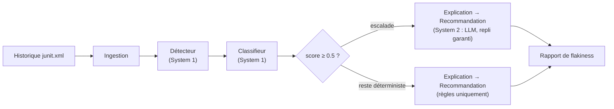

# FlakySense

**Diagnostic d'instabilité de suite de tests — détecte, classifie et explique les tests flaky à partir de l'historique CI, par analyse statistique déterministe, augmentée d'une couche IA optionnelle.**

[](https://github.com/BazanJeremy/flakysense/actions/workflows/ci.yml)
[](tests/)
[](pyproject.toml)
[](LICENSE)

> 🇬🇧 [English version](README.en.md)

## Le problème

Un test flaky échoue puis repasse sans qu'une ligne de code ait changé. Le
coût réel n'est pas le test lui-même : c'est la fiabilité CI qui s'effondre.
Un pipeline rouge ne veut plus dire « défaut » mais « relance le job », les
re-runs en aveugle deviennent la norme, et les vraies régressions se cachent
dans le bruit. Le temps d'ingénieur part dans le tri manuel au lieu de la
correction.

FlakySense transforme un historique de rapports JUnit en diagnostic
actionnable : un score de flakiness, une cause probable, une explication
fondée sur les preuves et une action corrective — lisibles par un lead QA,
ou consommés directement par le pipeline.

## L'approche : la statistique décide, l'IA raconte

Un pipeline de quatre agents suivant le pattern System 1 / System 2
([ADR-001](docs/adr/ADR-001-orchestration-pattern.md)) : du déterminisme là
où passe le volume, du raisonnement LLM là où est la valeur.



**La décision « ce test est-il flaky ? » est 100 % déterministe**
([ADR-002](docs/adr/ADR-002-flakiness-scoring-heuristic.md)). Le score
combine trois signaux :

- **intermittence** (pondération 0.4) — maximale à 50 % d'échec ; un test
  qui échoue toujours est cassé, pas flaky ;
- **taux de bascule** (0.4) — alternances pass/fail entre runs consécutifs ;
- **instabilité de durée** (0.2) — dispersion relative des temps d'exécution.

Le score est amorti sous 4 runs d'historique : peu de données, pas de verdict
confiant. La classification de la cause — timing, ordre d'exécution,
environnement, contention de ressources — est tout aussi déterministe
([ADR-003](docs/adr/ADR-003-cause-classification-heuristics.md)) : chaque
heuristique score indépendamment, la plus forte gagne, et sous un plancher de
confiance le classifieur répond `unknown`. Il ne devine jamais.

**L'IA n'intervient que sur la narration.** Explication et recommandation
peuvent passer par un LLM, uniquement si le score atteint 0.5 et qu'une clé
API est configurée ([ADR-004](docs/adr/ADR-004-system2-llm-integration.md),
[ADR-005](docs/adr/ADR-005-system2-escalation-threshold.md)). Chaque étage a
un repli déterministe : la suite complète (60 tests) et la CI tournent avec
**zéro clé API**, et la sortie garde exactement la même forme.

## Ce que ça rend

```
$ flakysense data/samples/ci_runs
FlakySense - analyzed 5 tests across 10 runs: 3 flaky

tests/test_users.py::test_user_profile_cache
  flakiness 0.70 | cause: ordering (confidence 0.80) | path: system1_fallback
  explanation:    Test 'tests/test_users.py::test_user_profile_cache' failed 4 of 10
                  recorded runs (flakiness score 0.70). Probable cause: ordering
                  (confidence 0.80). Evidence: failures only at suite position(s) [3],
                  passes only at [2].
  recommendation: Isolate shared state between tests; rerun the test alone and under
                  randomized ordering to confirm the dependency, then remove it.
  ...
```

- **Codes de sortie convention grep**
  ([ADR-006](docs/adr/ADR-006-cli-contract.md)) : `0` = aucun test flaky,
  `1` = flakiness détectée, `2` = erreur d'analyse — un pipeline peut donc
  conditionner un gate directement sur la stabilité de la suite.
- **`--json`** : les rapports sérialisés depuis les modèles Pydantic,
  preuves complètes incluses — le schéma de la CLI est le schéma des modèles.

## Démo en local

```powershell
python -m venv .venv
.\.venv\Scripts\Activate.ps1
pip install -r requirements.txt
pip install -e .
python -m pytest                        # 60 tests, zéro clé API

flakysense data/samples/ci_runs         # historique d'exemple fourni (10 runs)
flakysense data/samples/ci_runs --json  # sortie machine
```

Ou via Docker ([ADR-007](docs/adr/ADR-007-container-packaging-scope.md)) :

```powershell
docker compose run --rm flakysense                             # historique d'exemple
docker run --rm -v C:\chemin\vers\reports:/runs:ro flakysense  # vos artefacts CI
```

## Stack technique

- **Python ≥ 3.12**, **Pydantic v2** pour tous les modèles — une seule
  dépendance runtime.
- **Ingestion JUnit XML** : le format que pytest, Playwright, Jest ou Maven
  Surefire savent tous émettre.
- **Couche LLM optionnelle** (Anthropic) : `pip install -e .[llm]` +
  `ANTHROPIC_API_KEY` — rien d'autre ne change ; sans clé, chaque étage suit
  son chemin déterministe.
- **CI GitHub Actions** sans Docker ni clé API. Chaque décision de design est
  documentée dans un ADR ([docs/adr/](docs/adr/)) ; ce que les tests ont
  attrapé — et ce que cela aurait coûté — est consigné dans
  [docs/bug-evidence.md](docs/bug-evidence.md).

## Limites explicites

- L'analyse exige un **historique de runs** : minimum 4 runs pour un score
  non amorti. Un rapport JUnit isolé ne suffit pas.
- Les heuristiques v1 sont calibrées sur des scénarios synthétiques
  documentés ([data/samples/](data/samples/README.md)) ; sur un historique
  réel volumineux, les seuils peuvent demander un réglage.
- Sortie console et JSON uniquement — pas de dashboard ni de suivi dans le
  temps à ce stade.
- Sans la couche LLM, explications et recommandations restent des gabarits
  déterministes — corrects, mais plus secs.

## Auteur

**Jérémy Bazan** — Ingénieur QA · AI-driven Quality —
[LinkedIn](https://www.linkedin.com/in/jeremy-bazan/) ·
[GitHub](https://github.com/BazanJeremy)

FlakySense fait partie d'une série d'outils QA augmentés par l'IA — voir
aussi [anomaly-sentinel](https://github.com/BazanJeremy/anomaly-sentinel).

## Licence

[MIT](LICENSE)
